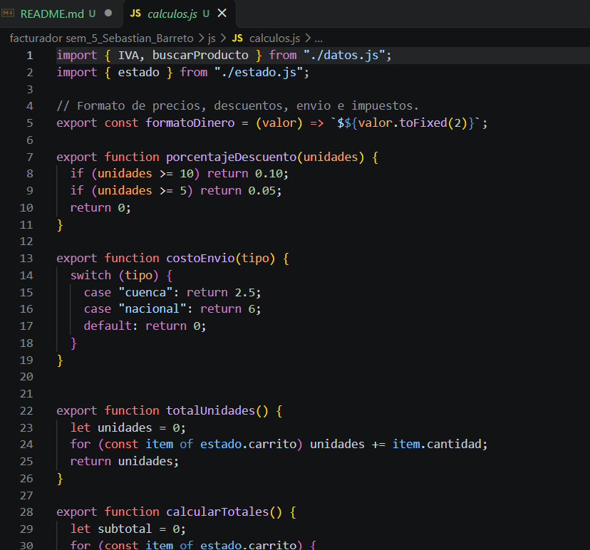
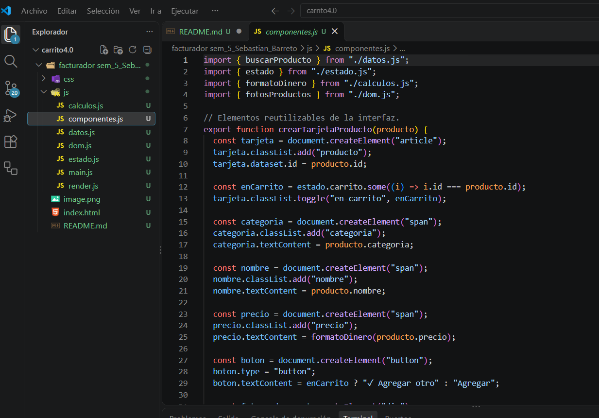
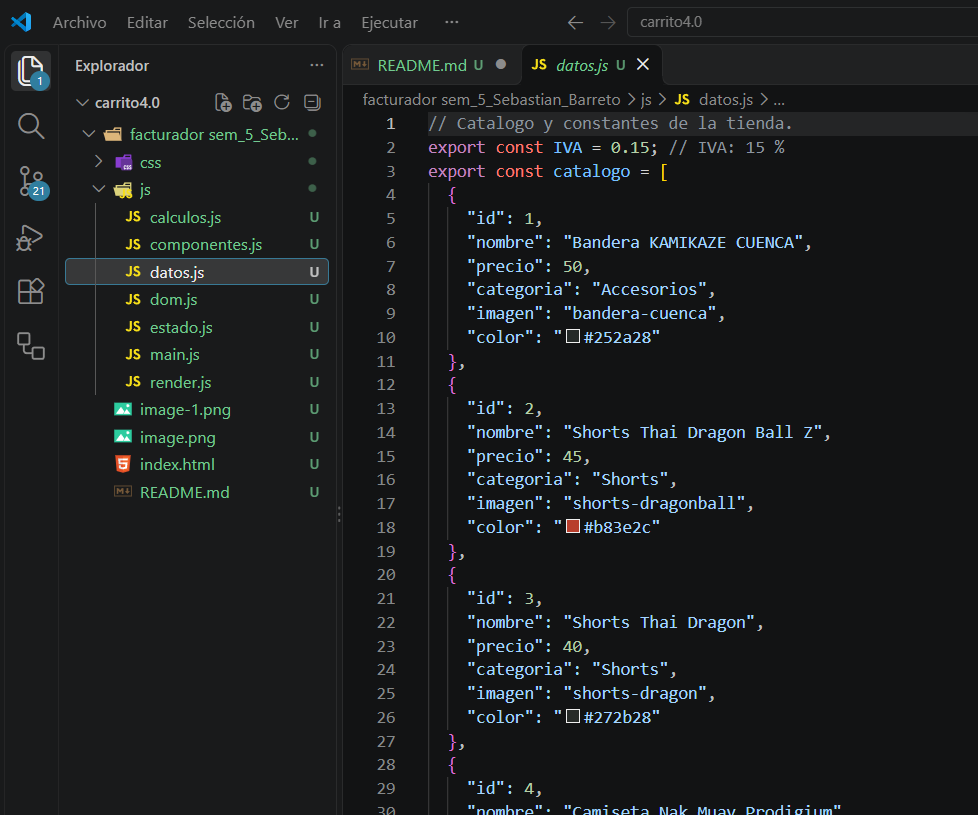
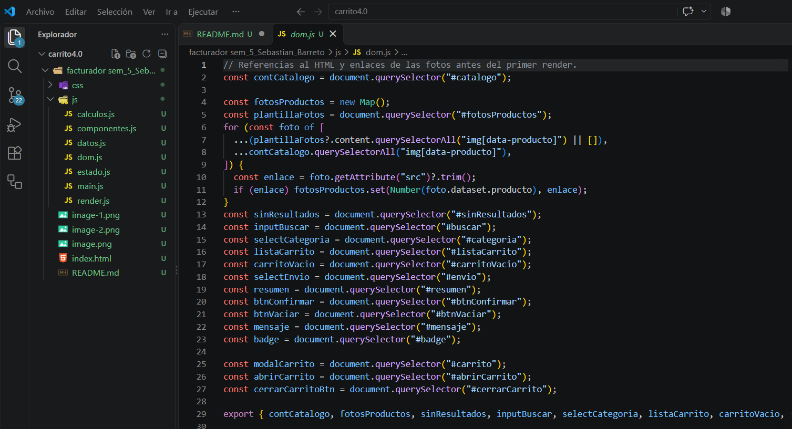
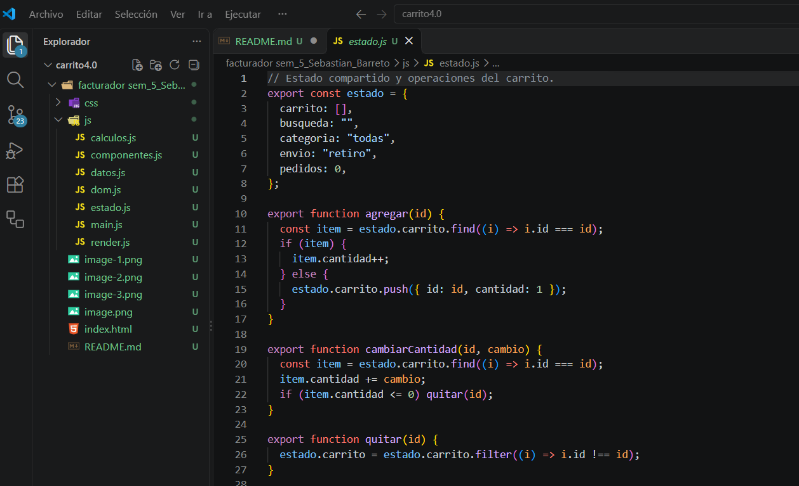
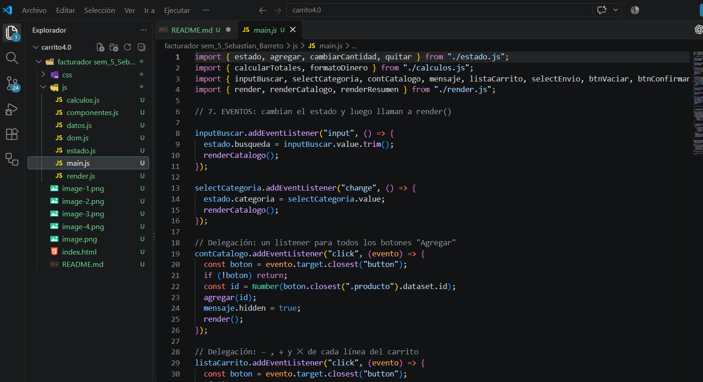
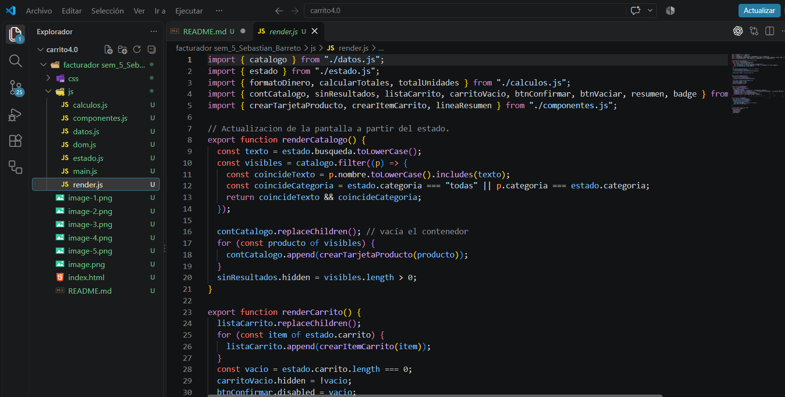

# Hecho por Sebastian Barreto
## tienda 
* actualiza los mudulos de js y de css a los de js los separe en 7
## calculos.js 

## componentes.js

## datos.js

## dom.js

## estado.js

## main.js

## render.js

* Use codex 